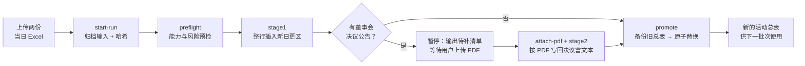

<div align="center">

# 券商公告日更 · Broker Announcement Daily Update

**一个面向 AI Agent 的 Skill：把每天的券商公告 Excel 安全并入长期总表，再依据原始 PDF 补录董事会决议。**

*An agent skill that safely appends daily Chinese securities-firm announcements to a long-lived master workbook, then fills in board resolutions strictly from the source PDFs.*

[](https://github.com/Ruoyu-Tianyi/broker-announcement-daily-update/actions/workflows/selftest.yml)


[为什么需要它](#-为什么需要它) · [工作流程](#-工作流程) · [快速开始](#-快速开始) · [命令参考](#-命令参考) · [安全保证](#-安全保证) · [目录结构](#-仓库结构)

</div>

---

## ✨ 亮点

- **只增不改**：整行插入新日更区，历史区的值、公式、样式、批注、超链接、合并关系、行高列宽逐格比对，任何意外差异即判定失败。
- **两阶段交接**：阶段一合并 Excel 并列出待补董事会决议清单后**强制暂停**；阶段二只依据用户上传的公告 PDF 写回，绝不凭标题或常识编造。
- **单元格内富文本**：写回格式为「标题 + 编号决议」，仅标题加粗、正文非粗体，而不是整格加粗。
- **可审计的工作区**：输入、阶段输出、最终输出与旧总表备份按「业务日期 / `run-NNN`」归档；SHA-256 防重复插入、防并发覆盖，原子替换活动总表。
- **纯文件级处理**：不操控 Excel、浏览器或桌面，不依赖本机 Office；所有动作都由可审计的 Python 脚本完成。
- **Agent 通用**：标准 `SKILL.md` 格式，可用于 Claude（Skills）、Codex（附 `agents/openai.yaml`）等支持 Skill 的 Agent。

## 🤔 为什么需要它

券商研究/合规岗常见的一项日常工作：每天从邮件收到「昨晚」「今早」两份新增券商公告 Excel，需要粘进一张维护多年的总表，按既有版式合并日期和券商单元格，再把其中董事会决议公告的具体决议内容逐条补进去。

人工做容易出错，直接交给通用 Agent 又更危险——它可能重排格式、拆掉合并单元格、整格加粗，甚至根据标题“猜”出决议内容。本 Skill 把这件事拆成有护栏的固定流程，让 Agent **能做、做对、做错时一定停下来**。

## 🔄 工作流程



| 阶段 | Agent 做什么 | 产出 |
| --- | --- | --- |
| 阶段一 | 读取两份来源表、映射字段、在最新日更区上方插入 `2 + n1 + n2` 行、复制表头与格式、合并相同日期/券商、识别并加粗董事会决议公告标题 | `阶段一.xlsx`、阶段一报告、待补清单 |
| 交接点 | 列出去重后的券商名单与逐公告明细（工作表 + 单元格），请求上传对应 PDF | — |
| 阶段二 | 逐份匹配 PDF、通读决议段落、提炼审议事项，写成「标题 / 1、… / 2、…」 | `最终.xlsx`、验证报告 |
| 晋升 | 核对哈希 → 备份旧总表 → 原子替换 → 复核 | 新活动总表 |

## 🚀 快速开始

### 1. 安装 Skill

```bash
git clone https://github.com/Ruoyu-Tianyi/broker-announcement-daily-update.git
cd broker-announcement-daily-update
pip install -r requirements.txt
```

把仓库内的 `broker-announcement-daily-update/` 子文件夹（含 `SKILL.md`）放进你的 Agent 的 Skill 目录；也可以直接下载 [Releases](https://github.com/Ruoyu-Tianyi/broker-announcement-daily-update/releases/latest) 里打包好的 zip，上传到支持 Skill 的客户端。

### 2. 自检

```bash
python broker-announcement-daily-update/scripts/workbook_engine.py selftest
```

```json
{
  "status": "pass",
  "openpyxl": "3.1.5",
  "stage1_history_check": true,
  "source_reconciliation": true,
  "rich_text_roundtrip": true
}
```

### 3. 对 Agent 说

> 使用 $broker-announcement-daily-update 更新券商公告总表，并在需要 PDF 时暂停给出待补清单。

首次使用时，Agent 会先介绍流程，并请你确认**专属工作区根目录**和**初始总表**（只复制，不移动原文件），之后每天只需上传两份 Excel，按清单补传 PDF 即可。

## 🧰 命令参考

脚本也可以脱离 Agent 单独使用（以下命令在 Skill 目录 `broker-announcement-daily-update/` 内执行）。

**工作区管理** — `scripts/workspace_manager.py`

```bash
# 首次初始化：建立目录并复制初始总表为活动总表
python scripts/workspace_manager.py init --root <工作区> --master <初始总表.xlsx>

# 开始一个批次：按业务日期归档两份来源 Excel，自动分配 run-NNN
python scripts/workspace_manager.py start-run --root <工作区> --date YYYY-MM-DD --source 昨晚.xlsx --source 今早.xlsx

# 把阶段二所需 PDF 归入同一批次
python scripts/workspace_manager.py attach-pdf --root <工作区> --date YYYY-MM-DD --run run-001 --pdf 公告1.pdf --pdf 公告2.pdf

# 验收通过后晋升最终文件为新的活动总表
python scripts/workspace_manager.py promote --root <工作区> --date YYYY-MM-DD --run run-001 --final 最终.xlsx --report 验证报告.json
```

**工作簿引擎** — `scripts/workbook_engine.py`

```bash
python scripts/workbook_engine.py selftest
python scripts/workbook_engine.py preflight --master 总表.xlsx --source 昨晚.xlsx --source 今早.xlsx --report 预检.json
python scripts/workbook_engine.py stage1    --master 总表.xlsx --source 昨晚.xlsx --source 今早.xlsx --output 阶段一.xlsx --report 阶段一.json
python scripts/workbook_engine.py stage2    --input 阶段一.xlsx --stage1-report 阶段一.json --resolutions 决议.json --output 最终.xlsx --report 阶段二.json
```

<details>
<summary><b>阶段二 <code>决议.json</code> 格式</b></summary>

每个待补项必须同时给出定位信息与 PDF 证据，脚本会拒绝缺项、重复单元格、标题不一致或 PDF 不存在的输入：

```json
[
  {
    "broker": "示例证券",
    "title": "示例证券：第三届董事会第十次会议决议公告",
    "sheet": "Sheet1",
    "cell": "C12",
    "pdf": "input/2026-08-28/run-001/pdf/01_示例证券决议公告.pdf",
    "items": [
      "审议通过《关于公司2026年半年度报告的议案》",
      "审议通过《关于修订〈公司章程〉的议案》"
    ]
  }
]
```

写回后的单元格：

```text
示例证券：第三届董事会第十次会议决议公告     ← 仅此行加粗
1、审议通过《关于公司2026年半年度报告的议案》
2、审议通过《关于修订〈公司章程〉的议案》
```

</details>

## 🛡️ 安全保证

| 风险 | 本 Skill 的处理 |
| --- | --- |
| 改坏历史数据 | 插入前对历史区与其他工作表做全量快照，保存重载后逐项比对；只允许整体下移 |
| openpyxl 丢失特性 | 预检发现公式、定义名称、外部链接、结构化表、条件格式、数据验证、图表、图片、宏、透视表、切片器等即**阻止写入**；打印机设置等 OOXML 部件从原文件恢复 |
| 编造决议 | 只接受本次清单产生后上传的 PDF；无文本层、缺页、附件缺失一律标记未解决，不写占位推测 |
| 误判公告类型 | 仅明确的「董事会……会议决议公告」进入清单；监事会、股东大会、董事会秘书等不计入 |
| 重复插入 | `start-run` 记录来源 SHA-256，同一对文件已处理则拒绝 |
| 覆盖他人修改 | 晋升前校验活动总表哈希仍等于批次开始时的值，否则停止 |
| 先覆盖后备份 | 固定顺序：备份旧总表 → 写临时文件并校验 → 原子替换 → 复核 |
| 误用旧附件 | 历史 `input` 只做审计，永不自动当作当日来源 |

## 🗂️ 专属工作区布局

```text
工作区/
├─ workspace.json                     # 工作区配置与活动总表哈希
├─ master/【日更】券商公告.xlsx         # 唯一活动总表
├─ input/YYYY-MM-DD/run-001/          # 当批来源 Excel、pdf/、run.json
├─ output/YYYY-MM-DD/run-001/         # 阶段一、最终文件与验证报告
└─ archive/master/YYYY-MM-DD/run-001/ # 每次晋升前的旧总表备份
```

## 📁 仓库结构

```text
.
├─ broker-announcement-daily-update/   # Skill 本体（安装时复制这个文件夹）
│  ├─ SKILL.md                         # 入口：触发条件、边界、两阶段流程
│  ├─ agents/openai.yaml               # Codex 等 Agent 的界面元数据
│  ├─ references/
│  │  ├─ first-use.md                  # 首次使用介绍与初始化交互
│  │  ├─ workspace-layout.md           # 工作区与总表生命周期
│  │  ├─ workbook-workflow.md          # 工作簿操作与验收清单
│  │  ├─ file-engine.md                # 文件级引擎说明
│  │  └─ resolution-extraction.md      # PDF 决议提炼与写回规范
│  └─ scripts/
│     ├─ workbook_engine.py            # 预检 / 阶段一 / 阶段二 / 自检
│     └─ workspace_manager.py          # init / start-run / attach-pdf / promote
├─ .github/workflows/selftest.yml      # CI：多平台自检
└─ requirements.txt
```

## ❓ 常见问题

<details>
<summary><b>为什么不直接转成 CSV 处理？</b></summary>

CSV 会丢失格式、合并单元格和单元格内富文本，而这些恰恰是总表版式的核心。本 Skill 全程在 `.xlsx` 上做文件级操作。
</details>

<details>
<summary><b>预检报出阻止项怎么办？</b></summary>

说明总表含有 openpyxl 无法无损迁移的特性。不要修改脚本绕过检查；应报告具体特性，换用另一种能无损处理该特性的文件级工具，或先与表格维护者确认。
</details>

<details>
<summary><b>PDF 第二天才拿到可以吗？</b></summary>

可以。PDF 会归入原 Excel 所在批次的 `pdf/` 目录；在阶段二完成并验收前，活动总表保持不变。
</details>

<details>
<summary><b>会自动去邮箱下载附件或去巨潮资讯网核验吗？</b></summary>

不会。邮件下载不在流程内，所有来源都由用户在当次对话中上传或点名；除非确实访问并核对了原始公告，否则不会宣称已在线核验。
</details>

## 🤝 贡献

欢迎提 Issue 与 PR。提交前请确认：

1. `python broker-announcement-daily-update/scripts/workbook_engine.py selftest` 通过；
2. 不提交任何真实业务数据（`.xlsx` / `.pdf` 已被 `.gitignore` 拦截）；
3. 修改安全边界相关行为时，同步更新 `SKILL.md` 与 `references/`。

---

<div align="center">
<sub>Made by <a href="https://tianyizhou.cn">Tianyi Zhou</a> · 金融数学 × 数据科学</sub>
</div>
